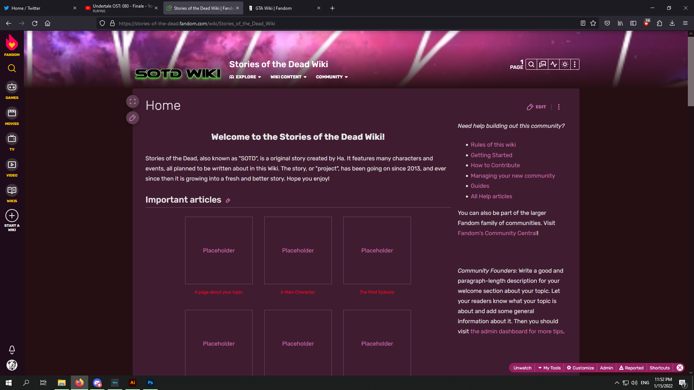

It has almost been a whole year since the website went live, isn't that crazy? There hasn't been much traffic, I appreciate that since this website is not finished yet. I remember I wanted to write newsletters for each month before the system was even done, I quickly gave up on that since there wasn't much to write about though...

I would like to go over every milestone Stories of the Dead managed to cross this year.

**January 4th** - The website went live for the first time, with lots of help from Taxtapy.

**February 26th** - The draft for "Black & White C-Side" was finished, with the release of the tenth chapter "CORE".

**June 7th** - The draft for "Black & White B-Side" was finished, with the release of the chapter "An Important Day".

**August 23rd** - The first "Totally Fine" comic was doodled, finally starting a somewhat consistent series I've been meaning to do for a long time.

**November 15th** - "Black & White" finally got its definitive ending, almost a year after its third act in the draft was finished. The story the draft was leading to, "The End of Black & White," was scrapped completely and everything will be cleared up in the inevitable rewrite. This ending won't change in the rewrite.

Looking back, there wasn't really much that happened. Jumping over the hurdle of making the website in the first place was definitely a major accomplishment though, this is something I've wanted for Stories of the Dead for a really long time.

Speaking of that, did you know I attempted making this website way back in 2022 through Fandom? Now you know. Good thing I didn't commit to that.

I'm so glad I have the website to work with now. It really helps with writing about characters and adding miscellaneous details to the project. I always wanted to make something interactive for people using Stories of the Dead, and with the website that dream is finally closer than ever.

What should you expect in the future?

It's just me on this website and progress is really slow. I don't know what you can expect from me, but the best part about this project is that you can contribute too in your own ways. Write your stories, characters, whatever comes into mind. Make your childhood dream also come true! We've all had our cringey made up ambitious stories since childhood, why not blow some dust off that and make something cool?

This project began as something personal, but I have chosen to make it a thing for everyone this year. I want Stories of the Dead to be one lively bubble for creations of all kind, developed with the dreams of creative minds like mine.

Of course as long as I'm still around all the submissions will have to go through me first. There is a detailed guide in the Discord server about contributing to this website (specifically #general-info), maybe you could check that out.

Keep creating, I believe in you.